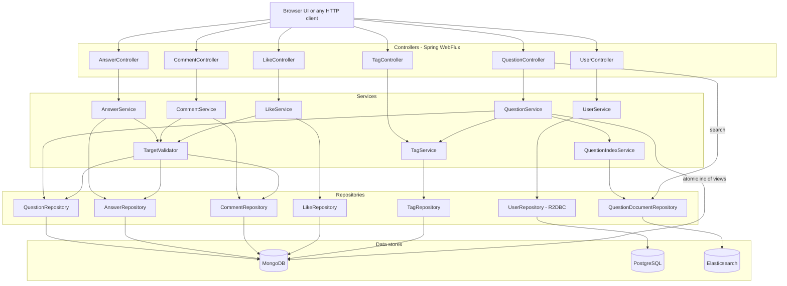
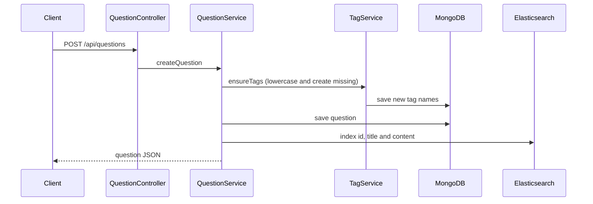
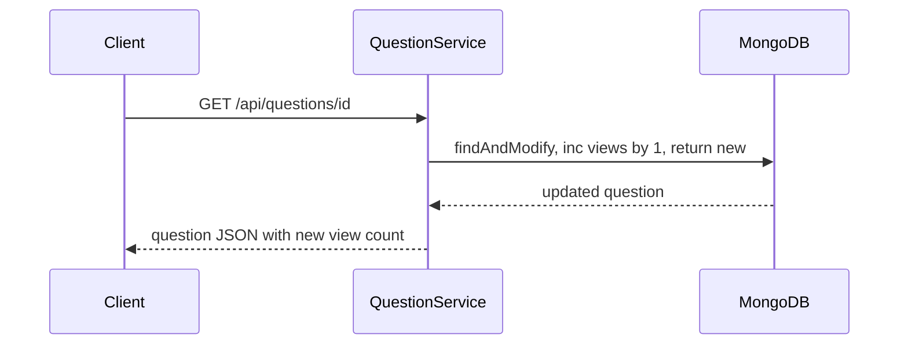
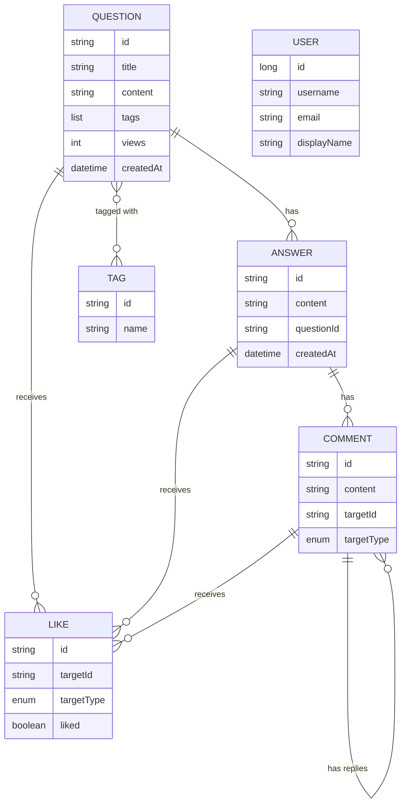
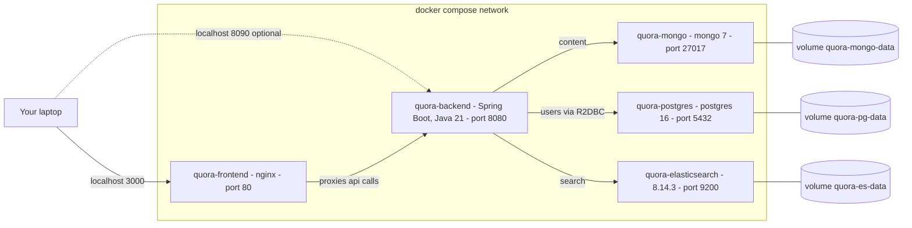
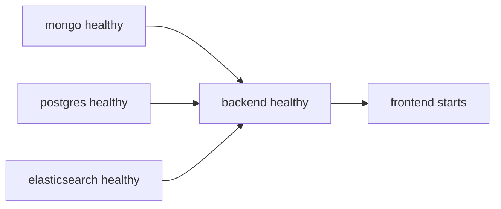

# Quora Clone - Reactive Q&A Backend

A Quora-style question and answer platform. Users post questions with tags, answer them, comment on answers (and reply to comments) and like or dislike questions, answers and comments. Questions are searchable with full-text search.

The backend is a reactive Spring Boot application. Data is split across three stores, each used for what it does best, and the whole stack runs in Docker with one command.

| Layer | Technology |
|---|---|
| Language and framework | Java 21, Spring Boot 3.5, Spring WebFlux (non-blocking) |
| Content (questions, answers, comments, likes, tags) | MongoDB 7 through Spring Data Reactive MongoDB |
| Full-text search | Elasticsearch 8 through Spring Data Elasticsearch |
| Users | PostgreSQL 16 through Spring Data R2DBC |
| Frontend | Plain HTML, CSS and JavaScript served by nginx |
| Packaging | Docker and Docker Compose |

## Contents

1. [Internal architecture](#internal-architecture)
2. [Docker architecture](#docker-architecture)
3. [Quick start](#quick-start)
4. [Configuration and credentials](#configuration-and-credentials)
5. [API reference](#api-reference)
6. [Demo data](#demo-data)
7. [Project structure](#project-structure)
8. [Known limitations](#known-limitations)

---

## Internal architecture

### Layers

Every request flows from a controller to a service to a repository to a data store. The `TargetValidator` service is shared by answers, comments and likes: it checks that the thing they attach to exists before anything is saved.



### What happens when you create a question



### What happens when you open a question

The view counter is incremented and the updated question is returned in one atomic Mongo operation (`findAndModify` with `$inc`), so concurrent readers never lose a view and the first response already shows the new count.



### Data model

Comments and likes point at their target with `targetId` and `targetType`, because they can attach to several kinds of thing. Users live in PostgreSQL and are not linked to the content yet.



| Rule | Detail |
|---|---|
| Answer needs | an existing question |
| Comment needs | an existing answer (`ANSWER`) or an existing comment (`COMMENT`). A comment on a question is rejected. |
| Like needs | an existing question, answer or comment |
| Tags | stored lowercase on the question, and once in the `tags` collection (unique name) |
| Deleting a comment | also deletes all replies below it |

---

## Docker architecture

`docker compose up` starts five containers on one private network. Only the frontend needs to be reachable from your laptop. The databases publish their ports too, for debugging.



### Containers

| Container | Image | Host port | Container port | Data volume |
|---|---|---|---|---|
| `quora-frontend` | built from `frontend/` (nginx 1.27) | **3000** | 80 | none |
| `quora-backend` | built from `Dockerfile` (Java 21 JRE) | 8090 | 8080 | none |
| `quora-mongo` | `mongo:7` | 27017 | 27017 | `quora-mongo-data` at `/data/db` |
| `quora-postgres` | `postgres:16` | 5432 | 5432 | `quora-pg-data` at `/var/lib/postgresql/data` |
| `quora-elasticsearch` | `elasticsearch:8.14.3` | 9200 | 9200 | `quora-es-data` at `/usr/share/elasticsearch/data` |

### Startup order

Each database has a health check. The backend starts only when MongoDB, PostgreSQL and Elasticsearch are healthy, and the frontend starts only when the backend is healthy. All containers restart automatically unless you stop them.



### How the frontend reaches the backend

nginx serves the static UI and forwards every `/api/...` request to `http://backend:8080` over the Docker network, so the browser only talks to one origin and no CORS configuration is needed. The backend refers to the other containers by service name (`mongo`, `postgres`, `elasticsearch`), never by `localhost`.

### Backend image

`Dockerfile` is a multi-stage build: a JDK 21 stage compiles the jar with the Gradle wrapper, and a slim JRE 21 stage runs it as a non-root user.

---

## Quick start

Requirements: Docker Desktop with at least 4 GB of memory, and free ports 3000, 8090, 27017, 5432 and 9200. Java, Gradle and Python are not needed on your machine, because everything runs in containers.

```bash
./start.sh                       # build, start, and load demo data if the app is empty
open http://localhost:3000       # the app
```

`./start.sh` checks that Docker is running, builds and starts the containers (the first build takes a few minutes), waits until the app answers, and loads about 10,000 demo questions only when the app has no data yet. Use `./start.sh --no-seed` to skip the demo data. If the script is not executable, run it with `bash start.sh`.

The same thing by hand:

```bash
docker compose up -d --build     # build and start everything
bash seed/load_seed.sh           # optional: load about 10,000 demo questions
```

| Task | Command |
|---|---|
| Stop everything (data is kept) | `docker compose down` |
| Start again | `docker compose up -d` |
| Rebuild after code changes | `docker compose up -d --build` |
| Backend logs | `docker logs -f quora-backend` |
| Container status | `docker compose ps` |
| **Wipe all data** | `docker compose down -v` |

### Data persistence

MongoDB, PostgreSQL and Elasticsearch each store their data on a named Docker volume, so it survives `docker compose down`, `restart`, rebuilds and reboots. It is deleted only by `docker compose down -v`, by `docker volume prune` while the stack is stopped, or by resetting Docker Desktop.

### Running on another machine

The data lives in Docker volumes on the machine that created it, not in this folder, so copying the folder gives you the code and a way to recreate the data, not the data itself.

1. Copy the project folder. You can leave out `build/`, `.gradle/` and `seed/out/`, because they are rebuilt.
2. On the other machine, install Docker Desktop and make sure the ports above are free.
3. Run `bash start.sh` inside the folder. It builds everything and loads the demo data. The data is generated with a fixed seed, so you get the same questions and ids as on the original machine.
4. Open http://localhost:3000.

Notes: the first run needs internet to download images and dependencies. On Windows use WSL or Git Bash. The backend container uses the time zone `Asia/Kolkata` (see the `TZ` variable below), so change it in `docker-compose.yml` if the new machine is in another zone.

---

## Configuration and credentials

**There are no API keys.** The API is open and has no authentication, so no key or token is needed to call it. The only credentials are the development defaults below, set in `docker-compose.yml`.

| Service | Username | Password | Database or notes |
|---|---|---|---|
| PostgreSQL | `quora` | `quora` | database `quora_db` |
| MongoDB | none | none | database `quora_db`, no authentication |
| Elasticsearch | none | none | security disabled |

These are for local development only. Do not expose these ports to a network you do not trust, and change the credentials before any real deployment.

### Backend environment variables

Set on `quora-backend` in `docker-compose.yml`. They override the defaults in `src/main/resources/application.yml`, which point at `localhost`.

| Variable | Value in Docker | Purpose |
|---|---|---|
| `SPRING_DATA_MONGODB_HOST` | `mongo` | MongoDB host |
| `SPRING_R2DBC_URL` | `r2dbc:postgresql://postgres:5432/quora_db` | PostgreSQL connection |
| `SPRING_ELASTICSEARCH_URIS` | `http://elasticsearch:9200` | Elasticsearch address |
| `JAVA_TOOL_OPTIONS` | `-Xmx512m` | JVM heap limit |
| `TZ` | `Asia/Kolkata` | Time zone. Timestamps are stored without a zone, so keep this equal to your local zone. |

---

## API reference

Base URL: `http://localhost:3000/api` through the frontend, or `http://localhost:8090/api` straight to the backend. Bodies and responses are JSON. Ids of questions, answers, comments, likes and tags are 24-character strings, and user ids are numbers.

Errors use Spring's standard JSON body: `timestamp`, `path`, `status`, `error` and `requestId`.

| Status | Meaning |
|---|---|
| 400 | Validation failed, or the combination of values is not allowed |
| 404 | The record, or the target it points at, does not exist |
| 409 | A unique value already exists (tag name, username or email) |

### Questions

| Method and path | Description | Success |
|---|---|---|
| `POST /questions` | Create a question | 200 and the question |
| `GET /questions?cursor=&size=` | Feed, oldest first, with cursor paging | 200 and a list |
| `GET /questions/{id}` | Get one question and **count one view** | 200 and the question |
| `GET /questions/elasticsearch?query=` | Full-text search, best matches first, top 20 | 200 and a list |
| `GET /questions/search?query=&page=&size=` | Case-insensitive substring search in MongoDB, paged | 200 and a list |
| `GET /questions/tag/{tag}?page=&size=` | Questions that carry a tag, paged | 200 and a list |
| `DELETE /questions/{id}` | Not implemented, returns a server error | none |

Create body:

```json
{ "title": "How does WebFlux work?", "content": "Explain the event loop", "tags": ["Java", "Spring"] }
```

Intended limits: title 10 to 100 characters, content 10 to 1000, at most 5 tags of at most 30 characters each. The UI enforces them, but this endpoint does not validate them yet.

Question response:

```json
{
  "id": "6acf1fca4e4650d683dfdfd8",
  "title": "How does WebFlux work?",
  "content": "Explain the event loop",
  "tags": ["java", "spring"],
  "views": 12,
  "createdAt": "2026-10-14T11:53:06.075"
}
```

Notes:
- **Feed paging:** the first call (no `cursor`) returns at most 10 questions. For the next page pass the `createdAt` of the last question you received as `cursor`.
- **Search results** from `/questions/elasticsearch` contain only `id`, `title` and `content`. The query tolerates typos and plurals, and a title match counts double.
- A question id that does not exist returns 200 with an empty body.

### Answers

| Method and path | Description | Success | Errors |
|---|---|---|---|
| `POST /answers` | Create an answer | 201 | 400, 404 if the question does not exist |
| `GET /answers/{id}` | Get one answer | 200 | 404 |
| `PUT /answers/{id}` | Replace the answer text | 200 | 400, 404 |
| `DELETE /answers/{id}` | Delete an answer | 204 | 404 |
| `GET /answers/question/{questionId}` | Answers of a question | 200 | |
| `GET /answers/question/{questionId}/latest` | Same, newest first | 200 | |
| `GET /answers/question/{questionId}/oldest` | Same, oldest first | 200 | |
| `GET /answers/question/{questionId}/count` | Number of answers | 200 and a number | |
| `GET /answers` | Every answer in the database (large, avoid on big data sets) | 200 | |

Create and update body (`content` 10 to 1000 characters):

```json
{ "content": "Publishers emit items to subscribers", "questionId": "6acf1fca4e4650d683dfdfd8" }
```

Answer response: `id`, `content`, `questionId`, `createdAt`, `updatedAt`.

### Comments

Comments attach to an answer (`ANSWER`) or to another comment (`COMMENT`), which gives threaded replies.

| Method and path | Description | Success | Errors |
|---|---|---|---|
| `POST /comments` | Add a comment or a reply | 201 | 400 if the target type is `QUESTION`, 404 if the target is missing |
| `GET /comments?targetId=&targetType=` | Comments on a target, oldest first | 200 | |
| `GET /comments/count?targetId=&targetType=` | Number of comments on a target | 200 and a number | |
| `GET /comments/{id}` | Get one comment | 200 | 404 |
| `PUT /comments/{id}` | Change the text | 200 | 400, 404 |
| `DELETE /comments/{id}` | Delete a comment **and all replies below it** | 204 | 404 |

Create body (`content` up to 500 characters):

```json
{ "content": "Great explanation", "targetId": "6acf1fd24e4650d683dfdfd9", "targetType": "ANSWER" }
```

Update body: `{ "content": "edited text" }`. Comment response: `id`, `content`, `targetId`, `targetType`, `createdAt`, `updatedAt`.

### Likes

A like can attach to a question, an answer or a comment. There is no user identity, so every request adds one more like or dislike; there is no per-user toggle.

| Method and path | Description | Success | Errors |
|---|---|---|---|
| `POST /likes` | Add a like (`isLike: true`) or a dislike (`isLike: false`) | 201 | 400, 404 if the target is missing |
| `GET /likes/count?targetId=&targetType=` | Totals for a target | 200 | 404 if the target is missing |
| `DELETE /likes/{id}` | Remove one like record | 204 | 404 |

```json
{ "targetId": "6acf1fd24e4650d683dfdfd9", "targetType": "ANSWER", "isLike": true }
```

Like response: `id`, `targetId`, `targetType`, `isLike`, `createdAt`. Count response: `targetId`, `targetType`, `likes`, `dislikes`.

### Tags

| Method and path | Description | Success | Errors |
|---|---|---|---|
| `POST /tags` | Create a tag. The name is lowercased. | 201 | 400, 409 if it exists |
| `GET /tags` | List all tags | 200 | |
| `GET /tags/{id}` | Get one tag | 200 | 404 |

Body: `{ "name": "kafka" }` (up to 30 characters). Tags used in a question are created automatically. Response: `id`, `name`, `createdAt`.

### Users

Stored in PostgreSQL. Users are not linked to questions, answers, comments or likes yet.

| Method and path | Description | Success | Errors |
|---|---|---|---|
| `POST /users` | Register a user | 201 | 400, 409 if the username or email is taken |
| `GET /users` | List all users | 200 | |
| `GET /users/{id}` | Get one user | 200 | 404 |

```json
{ "username": "hemant", "email": "hemant@example.com", "displayName": "Hemant" }
```

`username` is 3 to 50 characters, `email` must be valid (it is stored lowercase) and `displayName` is optional, up to 100 characters. Response: `id`, `username`, `email`, `displayName`, `createdAt`.

### Example session

```bash
API=http://localhost:3000/api

# ask a question
curl -s -X POST $API/questions -H 'Content-Type: application/json' \
  -d '{"title":"What is a reactive stream?","content":"Backpressure and publishers explained","tags":["java","reactive"]}'

# answer it (use the id from the response above)
curl -s -X POST $API/answers -H 'Content-Type: application/json' \
  -d '{"content":"Publishers emit items to subscribers","questionId":"<question id>"}'

# comment on the answer, then like the answer
curl -s -X POST $API/comments -H 'Content-Type: application/json' \
  -d '{"content":"Thanks","targetId":"<answer id>","targetType":"ANSWER"}'
curl -s -X POST $API/likes -H 'Content-Type: application/json' \
  -d '{"targetId":"<answer id>","targetType":"ANSWER","isLike":true}'

# search
curl -s -G $API/questions/elasticsearch --data-urlencode 'query=reactive stream'
```

---

## Demo data

The `seed/` folder generates and loads realistic demo content so the app is not empty:

- about 10,000 questions on Java, Spring Boot, SQL, Kafka, Docker, MongoDB and Elasticsearch
- about 25,000 answers, 43,000 comments and replies, 138,000 likes and dislikes, 68 tags
- 500 users in PostgreSQL

```bash
bash seed/load_seed.sh
```

The stack must be running. The script uses Python 3 if it is installed and otherwise runs the generator inside a temporary Docker container, so Docker is all you need. It is safe to run again: documents have fixed ids and are overwritten, not duplicated. The text is generated from a hand-written knowledge base in `seed/knowledge/` (so topics repeat with different wording), and view counts are random.

Queries that show off the search:

| Try searching for | Shows |
|---|---|
| `difference between hashmap and concurrenthashmap` | comparison questions |
| `n+1 query problem` | a topic found by an exact phrase |
| `LazyInitializationException` | an error message lookup |
| `hasmap` or `transactonal` | typo tolerance |
| `virtual threads java 21` | multi-word relevance |

---

## Project structure

```
.
├── Dockerfile                  backend image, multi-stage Gradle build
├── docker-compose.yml          the whole stack
├── start.sh                    one command: build, start, load demo data on first run
├── build.gradle
├── frontend/                   the web UI
│   ├── Dockerfile
│   ├── nginx.conf              serves the UI and proxies /api to the backend
│   └── public/                 index.html, app.js, style.css
├── seed/                       demo data generator and loader
│   ├── generate_seed.py
│   ├── load_seed.sh
│   └── knowledge/              topic content (Java, SQL, Spring, platform)
└── src/main/java/com/example/demo
    ├── controllers/            REST endpoints
    ├── services/               business logic, TargetValidator, QuestionIndexService
    ├── repositories/           MongoDB, R2DBC and Elasticsearch repositories
    ├── models/                 Mongo documents, Postgres User, Elasticsearch document
    ├── dto/                    request and response objects
    ├── adapter/                entity to DTO mapping
    └── utils/                  cursor and tag helpers
```

---

## Known limitations

- **No authentication or authorization.** Anyone can create, edit and delete anything, and users are not linked to the content.
- **Likes are anonymous.** Each request adds another like, and nothing stops repeats.
- **Deleting leaves orphans.** Deleting an answer keeps its comments and likes, and deleting a comment keeps its likes.
- **`DELETE /questions/{id}` is not implemented.**
- **Elasticsearch is updated only when a question is created.** Tags and answers are not indexed, and the search returns at most 20 results with no paging.
- **`POST /questions` does not validate input** (the UI does).
- **Unknown question ids return 200 with an empty body** instead of 404.

---

## Project tasks

1. [x] Integrate apis for tags

2. [x] Integrate apis for answers

3. [x] Integrate comments, comments can be done on a comment and comment can be done on an answer

4. [x] Integrate like, likes can be done on a question or answer or comments

